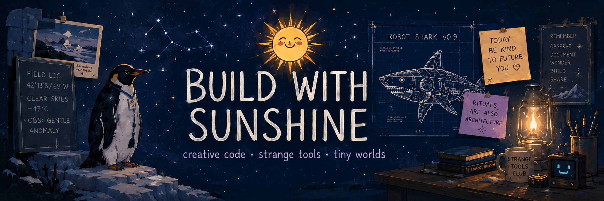

  

<h1 align="center">Sara | Build with Sunshine ☀️</h1>

  <b>Creative technologist building calm tools, weird little systems, and projects that probably should not exist</b>

  Code as workshop. Projects as worlds. Learning as field research.

---

## ✦ Current Lab Status

<table>
  <tr>
    <td width="65%" valign="top">

<table>
  <tr>
    <td><b>Learning</b></td>
    <td>Python · JavaScript · interaction design · robotics foundations</td>
  </tr>
  <tr>
    <td><b>Building</b></td>
    <td>calm learning tools · creative coding experiments · tiny digital worlds</td>
  </tr>
  <tr>
    <td><b>Exploring</b></td>
    <td>language, memory, interface emotion, playful systems</td>
  </tr>
  <tr>
    <td><b>Mood</b></td>
    <td>structured chaos, but with better lighting</td>
  </tr>
</table>

  </td>
  <td width="35%" valign="top">
<h3>📡 Studio Signals</h3>

<b>Focus:</b> Deep field

<b>Energy:</b> ◉ ◉ ◉ ○ ○

<b>Weather:</b> quiet chaos

<b>Current spell:</b> build anyway

  </td>
  </tr>
</table>

---

## ✦ Languages & Tools

  
  
  
  
  
  
  

---

## ✦ Currently Building

<table>
  <tr>
    <td width="33%">
  <h3>🍋 Lemon Hour</h3>
  
A summer music world spanning a listening website, LemonPod, and a companion app for creating, keeping, and revisiting memories tied to songs.

  
<i>Private and personal. Built slowly, with intention.</i>

</td>
    <td width="33%">
      <h3>🐧 Northern Institute</h3>
      
A soft winter-themed Russian learning experience focused on atmosphere, speech, and calm interaction.

      
<i>Private for now. Still forming. Still teaching me things.</i>

    </td>
    <td width="33%">
      <h3>🦈 Robot Shark Companion</h3>
      
A local AI desk companion concept with memory, personality, and eventually a body.

      
<i>Equal parts practical assistant and tiny menace.</i>

    </td>
  </tr>
</table>

---

## ✦ Public Project Shelf

<table>
  <tr>
    <td width="50%" valign="top">
      <h3>
        
          🌞
          Build with Sunshine
        
      </h3>
    
My public portfolio and front desk for selected creative technology projects, interactive experiments, and larger project worlds.

      
<i>Status:</i> ongoing / public portfolio / AI-assisted development

    </td>
    <td width="50%" valign="top">
      <h3>
        
          🍋
          Things Left in August
        
      </h3>
      
A small interactive August still life built publicly as an independent front-end learning project.

      
<i>Status:</i> planned public build / independently developed practice project

    </td>
  </tr>
</table>

---

## ✦ Field Notes

- I like software that feels intentional and breathes.
- I’m interested in learning to use tools in ways that reduce pressure instead of adding noise.
- I build slowly, notice too much, and make things that probably should not exist.
- I care about atmosphere, interaction, and the small details that make a system feel alive.

---

  <i>We do not just write code. We leave little signals for future selves.</i>

